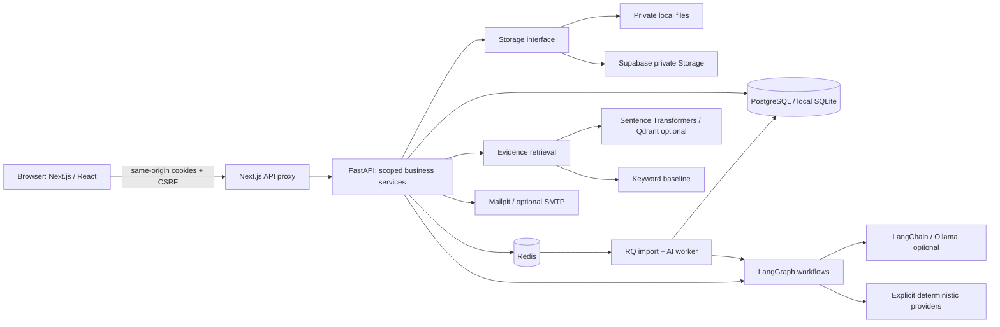

# System architecture

CampusMind extends one Next.js frontend and one FastAPI application. SQLAlchemy owns structured domain records. PostgreSQL is the intended persistent database; SQLite is an explicitly supported single-process development/test fallback. The code does not depend on a paid API.

## Identity and authorization

Every user belongs to one institution; login combines institution slug and roll number/email. Institution-owned records have an indexed `institution_id`. User roll/email uniqueness is per institution. `current_user` resolves a hashed opaque session and checks expiry/active status; mutations validate a session-bound CSRF token. `require`, `scoped` and `student_access` enforce roles, tenant ownership and coordinator department scope. Platform administrators remain scoped to their assigned institution; there is no global cross-college console.

Supabase is used as PostgreSQL/private storage, not as a second frontend authentication system. Its anonymous/authenticated Data API roles have application-table privileges revoked and RLS enabled without public policies. Tenant enforcement for the backend remains explicit application authorization; this is not transaction-scoped per-tenant database RLS. Checkpoints live in a private schema. Operator/runtime privilege separation needs strengthening before a real deployment.

## Domain and transactional boundaries

CSV preview normalizes and validates every row, records row errors and computes an institution-specific file/mapping/policy fingerprint. Confirmation is an atomic job transition. Accounts and progress commit in 100-row batches; token delivery is separate and recoverable. A 15-minute renewable lease and batch fencing support recovery after an ephemeral host dies. Import history retains counters and errors; raw CSV rows can be pruned by the configured retention command. No import launches per-student LLM calls.

Resume bytes and extracted text use separate randomized private storage keys. Versions have a per-student uniqueness constraint. Source claims remain distinct from assessment evidence. Skill taxonomy names are unique per institution, with conflict-safe insertion. A confirmed claim is still a claim.

Drive conditions are officer-authored or officer-approved. Draft changes invalidate earlier review. The full lifecycle supports reviewed, published, open, closed and completed states; direct officer-authored publication records explicit human review. An AI extraction never writes CGPA, backlog, branch or graduation restrictions. Deterministic checks include explanations; uncertain conditions require human review, with a recorded appeal/decision workflow. Publication uses cohort inputs loaded in bounded queries and does not invoke one model per student.

Assessment publication requires an approved bank. Each attempt stores a server-owned question snapshot, deadline, saved answers and exact marking version. Active responses redact answer keys/explanations. PostgreSQL row locks serialize attempt submission and roadmap acceptance. Late responses cannot replace saved pre-deadline answers. Subjective marks require an authorized examiner. Code exercises are stored text and never executed.

Learning goals, evidence, drives and submitted scores can propose versioned plans. The student explicitly accepts a proposal. Acceptance archives the prior plan and checks for newly completed tasks again. Completed tasks remain recorded; validation is separated from repeating a completed lesson. Estimated task hours and the available study budget are separate fields.

## AI and retrieval boundaries

LangGraph executes explicit authorization, analysis/validation and persistence nodes with checkpoint thread IDs containing tenant, actor and run identity. The model provider uses structured Pydantic output, fixed prompts, timeouts, bounded retry and no unrestricted tool executor. Workflow history identifies provider, method/prompt version, latency, state and safe failure. Only the requesting actor can inspect a workflow. Retry rechecks current permissions.

Institutional text is validated and extracted, split into overlapping chunks and indexed with source/version/page metadata. Optional embeddings run on CPU using cached Sentence Transformers weights. Qdrant filters include tenant and authorized live document IDs; every hit is revalidated against approval, expiry and department scope in the database. New approved versions supersede prior retrieval sources. Keyword fallback is explicit. Model-assisted source selection can only select authorized IDs; rendered findings use original excerpts.

The career coach is read-only with a fixed set of authorized record queries. It has no SQL/shell tool and cannot mutate another student, activate a plan or grade a written answer. Its fallback summarizes the student's own records and labels its provenance. Conversation context is bounded.

## Local versus hosted operation

Local Compose runs PostgreSQL, Redis/RQ and Mailpit. An optional AI profile adds Ollama/Qdrant and a heavier embedding image. Native SQLite mode runs the same core services synchronously without Docker or models.

Render Free uses one container with a public Next.js process and a loopback FastAPI process. All durable records/checkpoints live in Supabase PostgreSQL and files in its private bucket. Hosted rate limits are database-backed. No free background worker or local model is assumed; synchronous imports and keyword/deterministic intelligence remain usable. The startup supervisor terminates the sibling process if either server fails. Free-host memory, timeout and availability limits remain deployment constraints, not a production SLA.

See DIAGRAMS.md, API.md, SECURITY.md and DEPLOYMENT.md for the ER model, contract, safeguards and configuration.
