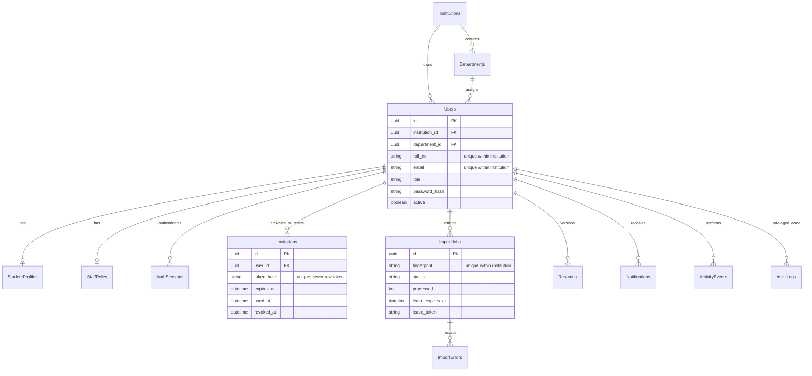
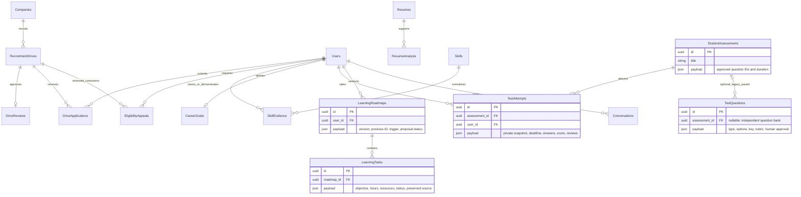
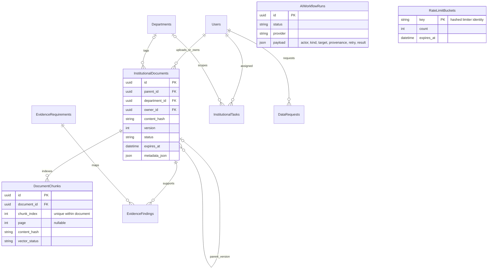
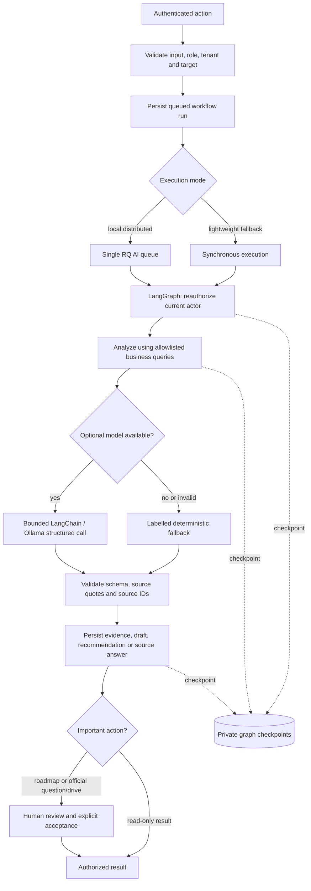
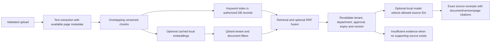
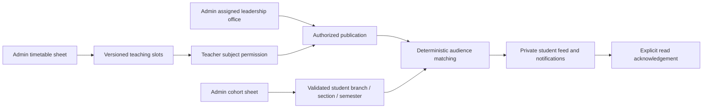

# Database and workflow diagrams

Every domain table below is institution-owned through an indexed `institution_id`, except the institution root and hashed global rate-limit buckets. Repeated tenant relationships are omitted from the diagrams for legibility. Payload records include a schema version and are validated at their service/API boundaries. Foreign keys, per-institution account uniqueness, per-student resume version uniqueness and controlled skill-name uniqueness are enforced in the database.

## Identity and onboarding

## Placement, assessments and preparation

## Institutional evidence and reliability

LangGraph checkpoint tables are managed by its installed checkpointer library, separately from domain migrations. They use a private PostgreSQL schema or a local SQLite file; neither has a browser-facing read endpoint.

## Bounded agent execution

## Evidence retrieval

## Academic distribution

